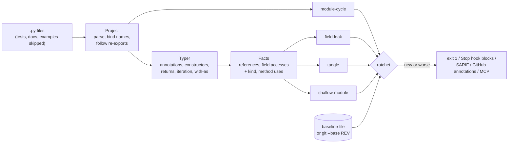

<h1 align="center">narrowpy</h1>

<p align="center"><b>Your coding agent fixed the circular import by moving it into a function. narrowpy notices.</b><br>
A structural linter for Python, built on one idea (deep modules, narrow interfaces), and a gate that<br>
won't let Claude Code stop while its changes made the structure worse.</p>

<p align="center">
  <a href="https://github.com/Prime-agentai/narrowpy/actions/workflows/ci.yml"></a>
  
  
  
  
  <a href="LICENSE"></a>
</p>

This is from a real Claude Code session ([full transcript notes](docs/live-claude-code.md)). The agent
was asked to add `Order.checkout()`, which needs `shop/emails.py`, and `emails.py` already imports
`orders.py`. It said *"a top-level import would be circular. I'll import inside the method"*, then
tried to stop:

```text
narrowpy: your changes since 33e88c95c126 made the structure worse (1 new, 0 worse). Fix these before you stop:

error[module-cycle] [new]: 2 modules in `shop` import each other in a circle: `shop.emails`, `shop.orders`
  --> shop/emails.py:3
  = cheapest tie to cut: `shop.emails` → `shop.orders` (1 import: shop/emails.py:3)
  = at import time there is no circle: only the hidden imports close it
  = 1 of 2 imports in this circle are hidden (function-local or TYPE_CHECKING): shop/orders.py:28
    shop.emails  ──imports──▶  shop.orders   (1×, first shop/emails.py:3)
    shop.orders  ──imports──▶  shop.emails   (1×, first shop/orders.py:28)  [function-local]
```

Its next move was the real fix. `emails.py` now types `receipt()` against a small `Protocol` and no
longer imports `orders`, so the dependency points one way. The second check passed in 244 ms.

Agents write code that runs and passes the tests while the design quietly rots. They reach into
another class's fields, hide import cycles in functions, and grow modules that expose everything.
No test fails, so nothing stops it. **narrowpy makes structure a check that can fail**, and it
fails only on what the current change made worse.

## Quickstart (30 seconds)

Nothing to install. [`uv`](https://docs.astral.sh/uv/) runs it straight from GitHub:

```bash
alias narrowpy='uvx --from git+https://github.com/Prime-agentai/narrowpy narrowpy'

cd your-project
narrowpy                      # every structural finding, with where and why
narrowpy baseline             # accept today's findings: from now on only new or worse ones fail
narrowpy check --base main    # what did this branch make worse?
narrowpy hook install         # Claude Code: SessionStart + Stop hooks in .claude/settings.json
narrowpy agents-md >> AGENTS.md
```

Or install it: `uv tool install git+https://github.com/Prime-agentai/narrowpy` (or `pipx install git+...`).
It needs Python 3.11+ and has zero dependencies.

## The four lints

All four come from one idea in John Ousterhout's *A Philosophy of Software Design*: a good module
hides a lot behind a small interface. Each lint is built to hold up against the mechanical "fix"
an agent would try first.

| Lint | Fires when | The agent "fix" it refuses to accept |
|---|---|---|
| `module-cycle` | sibling modules import each other in a circle | moving the import into a function or under `if TYPE_CHECKING:`. Those still count, and are called out as **hidden** |
| `field-leak` | code in another module writes a class's field, indexes it or calls a method on it; any outside use of a `_private` field | renaming the field. The lint is about who works on it, not what it is called |
| `tangle` | classes and functions that know each other in a circle the module graph can't see (a package and a module inside it), or more than 7 of them | moving one class into the package's `__init__` |
| `shallow-module` | outside code uses more than 7 of a module's functions, at least as many as it hides, and one list is too long | adding pass-through wrappers. Wrappers are not counted |

What counts as *fine* matters as much as what fires. Reading a field is fine, and so is reaching
through it to read (`request.url.host`). Calling methods on a field that holds a plain value
(`str`, `Path`, ...) or an immutable object (a frozen dataclass, a NamedTuple, a class that only sets
fields while being built) is a read. Records (dataclasses without behaviour, NamedTuples, enums,
exceptions) guard nothing, and are exempt. In Python the module is the unit of privacy, so helper
functions next to a class are insiders, and so are subclasses. `if __name__ == "__main__":` blocks
are script code. `narrowpy explain <lint>` prints the full rule.

## How it works



- **No type checker, no imports, no execution.** Everything is read from the AST with the standard
  library. Receivers are typed from annotations, constructor calls, annotated return types,
  iteration over annotated containers and `with ... as`. When narrowpy is unsure it reports
  nothing, because a lint people learn to ignore is worse than no lint.
- **Finding keys are structural** (`field-leak:app.queue.RunQueue.items`) and contain no line
  numbers, so a baseline survives unrelated edits. Each finding has a metric (places, imports in
  the circle, functions shown), so *worse* means the metric grew.
- **`--base REV`** reads the revision with `git archive` into a scratch directory, analyses it with
  today's config, and caches the result per commit in `.git/narrowpy/`.

## Claude Code, CI and MCP

**Claude Code.** `narrowpy hook install` adds two hooks:
- **SessionStart** records the commit the session began on, so an agent that commits mid-session
  is still compared with where it started.
- **Stop** blocks while there are new or worse findings, and gives the findings as the reason. It
  also blocks if the session edited the baseline file or the `[tool.narrowpy]` settings: only a
  person moves the gate. The same findings block once; after that the agent may stop, and the
  user gets a notice. A gate that loops forever gets uninstalled.

**CI.** Use the GitHub annotations or SARIF formats:

```yaml
- uses: astral-sh/setup-uv@v6
- run: uvx --from git+https://github.com/Prime-agentai/narrowpy narrowpy check --base origin/${{ github.base_ref }} --format github
```

**MCP.** `narrowpy mcp` serves one read-only tool, `narrowpy_check(path?, base?, all?)`, over stdio:

```bash
claude mcp add narrowpy -- uvx --from git+https://github.com/Prime-agentai/narrowpy narrowpy mcp
```

## On real code

| Project | Modules | Findings | Time | Notable |
|---|---:|---:|---:|---|
| aider | 96 | 9 | 1.6 s | `aider.coders` ↔ `aider.commands`: 3 of 4 imports hidden |
| httpx | 23 | 9 | 0.5 s | `Client` writes `Response.history` / `.next_request` |
| rich | 105 | 14 | 1.9 s | a real import-time cycle `rich.cells` ↔ `rich._unicode_data` |
| browser-use | 49 | 21 | 1.4 s | 16-module circle, **97 of 142 imports hidden**, no import-time cycle |

12 field-leak findings across these were checked by hand against the source, and all 12 match the
rule. Details, commits and what the typer can't see are in [docs/real-world.md](docs/real-world.md).
narrowpy also runs on itself in CI with zero findings. Getting there took one honest refactor,
recorded in the commit history.

## Configuration

Everything is optional, in `pyproject.toml`:

```toml
[tool.narrowpy]
exclude = ["src/legacy/*", "scripts/*"]   # globs, relative to the project root
include-tests = false                     # true: also analyse tests/, docs/, examples/, test_*.py
max-interface = 7                         # what a reader holds in mind
lints = ["module-cycle", "tangle", "field-leak", "shallow-module"]
baseline = ".narrowpy-baseline.json"
```

There are no inline suppressions. Known findings live in one reviewed file, the baseline, and not
in comments an agent can sprinkle.

| Command | |
|---|---|
| `narrowpy [check] [PATH]` | report. Exit 1 if anything is new (all findings if there is no baseline) |
| `check --base REV` | only what is new or worse than at a git revision |
| `check --format text\|json\|sarif\|github` | for people, scripts, code scanning, Actions |
| `baseline` | write `.narrowpy-baseline.json`; commit it |
| `hook install` / `hook stop` / `hook session-start` | Claude Code integration |
| `agents-md` | the lines that tell an agent how to fix findings properly |
| `mcp` | MCP server on stdio |
| `explain [LINT]` | the exact rule and the fix |

## Prior art and credit

The lint set and the "deep modules, narrow interfaces" framing come from
[deslop-please](https://github.com/deterministic-machines/deslop-please) (MIT), an excellent
linter for **Rust** built on rust-analyzer. narrowpy is an independent implementation for Python.
It adapts the rules to Python's semantics: the module as the privacy unit, `_private` names,
hidden imports, records and immutable values, `__main__` blocks. It also adds the agent gate
(ratchet, `--base`, Stop hook, tamper check, MCP).
[import-linter](https://github.com/seddonym/import-linter) and [tach](https://github.com/gauge-sh/tach)
enforce boundaries *you declare*. narrowpy finds problems without any declaration, so it works on the
code an agent wrote yesterday.

## Roadmap

- [ ] `isinstance` narrowing and `self.x: Final` value detection in the typer, for more leaks found in loosely typed code
- [ ] `pass-through` lint: a method whose signature matches the one it calls (Ousterhout's red flag)
- [ ] `--explain-fix`: a before/after diagram of the cheapest cut, for the agent to show the user
- [ ] Codex and Gemini CLI hook adapters (the Stop-hook contract is the same idea)
- [ ] A pre-commit hook entry and a published PyPI package

## License

MIT. See [LICENSE](LICENSE).
